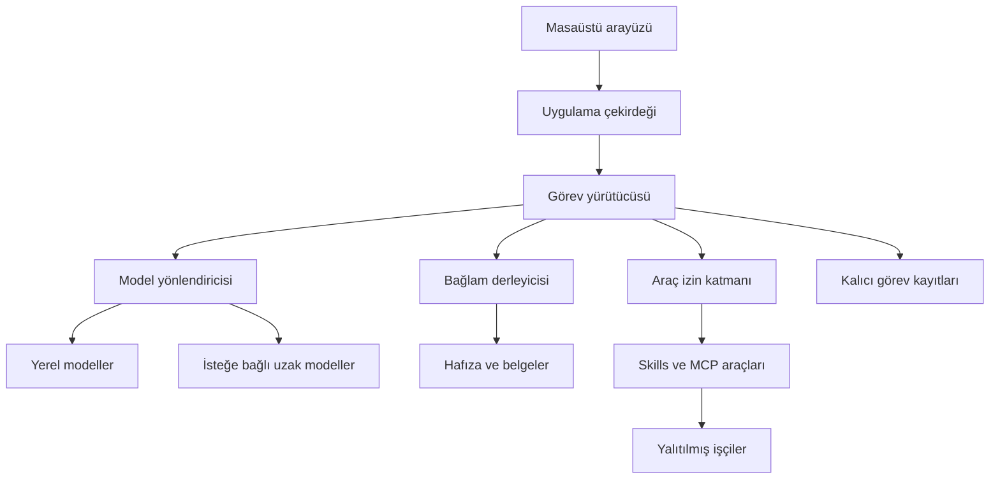

# Cursor için kişisel yapay zekâ geliştirme şartnamesi

**Proje sahibi:** Ümit Erdoğan  
**Hazırlanma tarihi:** 4 Kasım 2026  
**Belge sürümü:** 1.0  
**Muhatap:** Cursor geliştirme ajanı  
**Durum:** Gereksinim ve mimari şartnamesi. Uygulama geliştirmeye başlama onayı değildir.

Yerel modeller çalıştırabilen, sahibinin kendi yeteneklerini yazabildiği, gerçek fine-tuning ile uyarlanabilen bir kişisel yapay zekâ sistemi geliştir. Referans görüntüdeki NoX 0.9.0 arayüzünün gösterdiği işlevleri kapsa; bunların üzerine model bağımsızlığı, kalıcı görev yürütme, kaynaklı hafıza, ölçülebilir kalite ve denetlenebilir otomasyon ekle.

Hedef yalnızca bir sohbet ekranı değildir. Kullanıcının modellerini, verisini, yeteneklerini ve görevlerini yönetebildiği; bileşenlerini değiştirebildiği; yapılan işlemleri görebildiği bir kişisel asistan platformudur. Yenilik, özellik sayısıyla değil, tamamlanan görevlerin doğruluğu, sürdürülebilirliği ve kullanıcıya sağlanan kontrolle değerlendirilecektir.

Donanım, işletim sistemi, bütçe ve veri sınırları henüz doğrulanmamıştır. Bu belgede tanımlanan teknoloji yığını tasarım başlangıcıdır. Önce Bölüm 2 kapsamındaki keşfi tamamla ve kullanıcı onayını al. Ardından yalnızca onaylanan aşamayı uygula.

## 1 Referansın kapsamı ve temel ayrımlar

Referans, kullanıcı tarafından paylaşılan ekran görüntüsü ve şu sahip beyanıdır: “Lokal AI’lar kurabilirsin fakat bu benim kendi fine-tuning yaptığım, skill’lerini bizzat yazdığım kişisel AI.”

Görüntüde NoX 0.9.0 adı, `nox:latest` model etiketi, oturumlar, yetenek anahtarları, Tor kontrolleri, belge ve hafıza erişimi, görev ve çalıştırıcı düğmeleri görülmektedir. Arka plandaki kod, temel model, eğitim kayıtları ve araçların çalışması doğrulanmış değildir. Bu nedenle NoX’un performansı veya gerçek mimarisi hakkında iddia üretme. Karşılaştırmayı görünen işlevler ve bu projenin ölçülen sonuçları üzerinden yap.

### 1.1 Kavramları ayrı yönet

| Kavram | Sistemdeki karşılığı | Model eğitimi sayılır mı |
| --- | --- | --- |
| Yerel çıkarım | Modelin kullanıcının cihazında cevap üretmesi | Hayır |
| Sistem talimatı ve kişilik | Asistanın dili, üslubu ve çalışma kuralları | Hayır |
| Modelfile | Ollama model paketinin ve çalışma davranışının yapılandırılması | Tek başına hayır |
| Skill | Görev talimatları, ilişkili kaynaklar ve gerekirse araç kullanım akışı | Hayır |
| Tool | Dosya, web veya başka sistem üzerinde gerçek işlem yapan işlev | Hayır |
| RAG | İlgili belgeleri bulup cevap bağlamına eklemek | Hayır |
| Hafıza | Onaylanmış bilgileri saklamak ve gerektiğinde geri getirmek | Hayır |
| Fine-tuning | Eğitim verisiyle modelin veya eğitim adaptörünün parametrelerini öğrenmek | Evet |

LoRA, temel ağırlıkları genellikle sabit tutup ek adaptör parametrelerini eğitir. QLoRA, nicemlenmiş temel model üzerinde LoRA eğitimi yaklaşımıdır. Bir modele yeni isim vermeyi veya sistem talimatı eklemeyi fine-tuning olarak etiketleme. [K1] [K2]

### 1.2 Başarı ölçüsü

“Daha iyi” ifadesini aşağıdaki sonuçlara bağla:

- Desteklenen modeli değiştirirken arayüzü, yetenekleri ve hafızayı yeniden yazmamak.
- Yeni bir yeteneği sürümlü paket olarak ekleyip test ederek etkinleştirebilmek.
- İşlem geçmişinden hangi modelin hangi aracı hangi yetkiyle kullandığını görebilmek.
- Kesilen bir görevi dış dünyadaki işlemleri gereksiz tekrarlamadan sürdürebilmek.
- Bir cevabın dayandığı belgeyi ve kullanılan sürümü açabilmek.
- Özel verinin nereye gönderildiğini kontrol edebilmek.
- Eğitimle elde edilen iyileşmeyi ayrı test verisinde ölçebilmek.

Bu sonuçları doğrulamadan ürünün NoX’tan daha başarılı olduğunu ilan etme.

## 2 Cursor için zorunlu başlangıç ve keşif

Bu belge verildiğinde hemen kod yazmaya, paket kurmaya, model indirmeye veya mevcut dosyaları değiştirmeye başlama. Önce mevcut çalışma klasörünü ve varsa `AGENTS.md` talimatlarını oku. Var olan projeyi sıfırlama. Kullanıcının verdiği cevapları tekrar isteme.

### 2.1 Netleştirilecek bilgiler

| Alan | Doğrulanacak bilgi | Belirlediği karar |
| --- | --- | --- |
| İşletim sistemi | Sürüm, işlemci mimarisi ve hedef platform | Paketleme ve platform desteği |
| Donanım | CPU, RAM, GPU, kullanılabilir VRAM ve boş disk | Model boyutu, bağlam ve eşzamanlılık |
| Kurulum yetkisi | Yönetici yetkisi, sürücü ve sanallaştırma kısıtları | Derleme ve yalıtım yaklaşımı |
| Çalışma konumu | Tek cihaz, yerel ağ veya başka bir sunucu | Yerel ve uzak model sınırı |
| İlk kullanım amacı | Kullanıcının önceliklendirdiği gerçek görevler | İlk çalışan sürümün kapsamı |
| Veri kapsamı | İşlenecek klasörler, dosya türleri, hacim ve hassasiyet | İndeksleme ve erişim politikası |
| Ağ kullanımı | Tam çevrimdışı gereksinimi, web ve uzak API izni | Çıkış politikası |
| Bütçe | API, donanım, eğitim ve varsa hizmet sınırı | Kaynak ve maliyet bütçeleri |
| Çalışma süresi | Uygulama kapalıyken, uyku sonrasında ve açılışta beklenen davranış | Zamanlayıcı ve arka plan işçisi |
| Eğitim | Mevcut veri, kullanım hakkı, hedef davranış ve eğitim donanımı | Fine-tuning yapılabilirliği |
| Entegrasyon | Gerçekten istenen dış sistemler ve erişim yetkileri | İlk bağlayıcılar |
| Dağıtım | Kişisel kullanım, paylaşım veya ileride çok kullanıcılı kullanım | Lisans, kimlik ve güncelleme modeli |

Bilinmeyen alanlara değer uydurma. Erişilebilen cihaz bilgilerini salt okunur olarak tespit et; erişemediğin bilgiyi kullanıcıdan iste. Soruları kısa tut, tek seferde bir karar alanına odaklan. Sonraki soruya geçmeden cevabı işle.

### 2.2 Keşfin çıktısı

Keşif sonunda tek bir uygulanabilir çözüm sun. Seçilen teknoloji yığınını, kesinleşmiş kapsamı, bekleyen bağımlılıkları, kaynak ihtiyacını ve ilk aşamanın kabul koşullarını açıkla. Donanımla uyumsuz tercih varsa gerekçeli değişiklik öner. Kullanıcı onayından sonra geliştir.

Modelin adı ve boyutu, donanım doğrulanmadan kesinleşmez. İnternetteki genel sıralamayı kullanıcının cihazındaki başarı kanıtı sayma. Referans makine ve kullanıcı görevleri üzerinde karşılaştırma yap.

## 3 Ürün ilkeleri

1. **Yerel çalışma temeldir.** Uzak model ve harici hizmet kullanımı ayrıca etkinleştirilir. Yerel model hatası, sessizce uzak servise geçiş sebebi değildir.
2. **Kullanıcı sahipliği korunur.** Konuşmalar, yetenekler, ayarlar ve hafıza belgelenmiş biçimlerde dışarı aktarılabilir.
3. **Model değiştirilebilir olur.** Uygulama mantığını tek bir modelin yanıt biçimine veya tek bir sağlayıcı SDK’sına bağlama.
4. **Yetkiyi yazılım uygular.** Modelin talimatlara uyması, dosya ve ağ erişiminin güvenlik mekanizması değildir.
5. **Özellik gerçekten çalışır.** Arayüz düğmesi, sahte ilerleme veya modelin “yaptım” demesi tamamlanma kanıtı değildir.
6. **Gelişme ölçülür.** Model, prompt, skill ve eğitim değişiklikleri aynı sürümlü değerlendirmelerle karşılaştırılır.
7. **Karmaşıklık gerekçeli eklenir.** İlk kişisel sürüm için Kubernetes, dağıtık kuyruk veya zorunlu bulut altyapısı kurma.
8. **Tek aşamayla ilerle.** Bir aşama doğrulanmadan ve kullanıcı sonraki aşamayı onaylamadan kapsamı büyütme.

## 4 Referanstan devralınacak işlevler

| Referansta görünen özellik | Bu projedeki gereksinim | İyileştirme |
| --- | --- | --- |
| Oturum oluşturma ve adlandırma | Oluşturma, yeniden adlandırma, arama, arşivleme ve silme | Çalışma alanı kapsamı, dışa aktarım ve konuşma dalları |
| Model seçimi | Yüklü ve yetkili modellerin listesi | Gerçek çalışma konumu, yetenek bilgisi ve sürüm kimliği |
| Thinking ayarı | Sağlayıcının desteklediği düşünme ayarı | Desteklenmeyen seçeneği gizlemek ve maliyetini açıklamak |
| Core Web Create Data grupları | Yeteneklerin işlevlerine göre gruplanması | Bağımlılık, izin ve çalışabilirlik durumları |
| Skill açma ve kapatma | Çalışma alanı ve görev düzeyinde yetenek kontrolü | Sürüm kilitleme, test sonucu ve işlem anında izin kontrolü |
| Klasörler | Kullanıcının seçtiği klasörlere erişim | Okuma ve yazma kapsamlarını ayrı yönetmek |
| Belgeler ve ekler | İçe aktarma, önizleme ve kaynaklı arama | Artımlı indeksleme ve dosya sürümü takibi |
| Hafıza | Görülebilen ve düzenlenebilen kalıcı bilgiler | Kaynak, tarih, çelişki yönetimi ve silme takibi |
| Şablonlar | Kullanıcının düzenleyebildiği görev şablonları | Parametre doğrulama ve sürüm geçmişi |
| Jobs ve runner | Sıraya alınan ve izlenen görevler | Kalıcı durum, süre sınırı, iptal ve yeniden başlatma |
| Arka plan | Arayüzden bağımsız yürütme seçeneği | Süreç yaşam döngüsünün açık kontrolü |
| Tor ve bağlantı testi | İsteğe bağlı ağ yönlendirmesi | Yetenek bazında rota ve başarısızlıkta doğrudan çıkışı engellemek |
| Private | Gizlilik durumu | Veri kalıcılığı, ağ ve model konumunu ayrı göstermek |
| Boost | Tanımlanmış yüksek kaynak profili | Model ve bütçe farkını önceden göstermek |
| Tema ve görsel kimlik | Açık koyu tema ve kişiselleştirme | Erişilebilirlik, klavye kullanımı ve okunabilirlik |
| Gönder ve durdur | Mesaj akışı ve görev iptali | Alt işçilere yayılan iptal ve gerçek işlem durumu |
| Kişisel model beyanı | Kişilik profili ve gerçek eğitim adaptörü yönetimi | Yapılandırma ile eğitimi ayrı etiketlemek |

Referansın görünümünü veya NoX adını kopyalamak zorunlu değildir. Ürün adı ve görsel kimlik kullanıcıyla kesinleşir.

## 5 Önerilen teknoloji yığını

Başlangıç tasarımı, kişisel masaüstü kullanımına uygun modüler bir uygulamadır. Aşağıdaki seçimler keşif onayıyla kesinleşir. Güncel desteklenen sürümleri ve lisansları kurulum tarihinde tekrar doğrula; bağımlılıkları kilit dosyalarına sabitle.

| Katman | Başlangıç tercihi | Seçim gerekçesi |
| --- | --- | --- |
| Masaüstü kabuğu | Tauri 2 | Yerel uygulama paketleme ve pencere bazında yetkilendirme |
| Arayüz | React ve TypeScript | Tipli, bileşenlere ayrılabilen kullanıcı arayüzü |
| Uygulama çekirdeği | Python ve FastAPI | Model, belge ve eğitim ekosistemiyle entegrasyon |
| Veri sözleşmeleri | Pydantic ve JSON Schema | Giriş, çıktı ve yapılandırma doğrulama |
| Görev yürütme | LangGraph ve kalıcı checkpointer | Durumlu akış, bekletme ve devam etme |
| Yerel model motoru | Ollama yerel sunucusu | Model yaşam döngüsü ve desteklenen modellerde araç çağırma |
| Uygulama kayıtları | SQLite | Yerel kalıcı veri, işlem kayıtları ve görev meta verisi |
| Sözcük tabanlı arama | SQLite FTS5 | Tam metin araması ve sözcük eşleşmesi |
| Vektör arama | Yerel gömülü LanceDB | Ayrı bir sunucu zorunluluğu olmadan vektör indeksi |
| Araç entegrasyonu | MCP ve uygulamaya ait araç adaptörleri | Taşınabilir entegrasyon sınırı |
| Web işlemleri | Playwright işçisi ve kontrollü HTTP istemcisi | Sayfa etkileşimi ile basit içerik alımını ayırmak |
| Ölçüm | OpenTelemetry ve yerel kayıt | Görev, model ve araç çağrılarının ilişkilendirilmesi |
| Doğrulama | Python testleri, arayüz testleri ve gerçek model değerlendirmeleri | Yazılım doğruluğu ile model başarısını ayrı ölçmek |

Tauri yetkileri arayüzün yerel komut erişimini sınırlar; Python araçlarını veya modelin oluşturduğu kodu kendiliğinden yalıtmaz. Python çekirdeğini paketlenmiş sidecar olarak çalıştırmak mümkündür. Windows geliştirmesinde C++ Build Tools, Rust ve WebView2 gereksinimlerini doğrula. “Yönetici yetkisi gerekmez” veya “her cihazda taşınabilir çalışır” diye peşinen söz verme. [K3] [K4] [K5]

FastAPI ve Pydantic uygulama sözleşmelerini taşır. SQLite ana kayıt kaynağıdır. FTS5 ve LanceDB yeniden kurulabilir arama indeksleri olarak ele alınır; iki depoda tek bir atomik işlem varmış gibi davranma. [K6] [K7] [K8] [K9]

Masaüstü dışı istemci ihtiyacı doğrulanırsa aynı çekirdek API’si kullanılabilir. İlk aşamada ikinci bir istemci veya çok kullanıcılı sunucu geliştirme.

## 6 Mimari ve bileşen sınırları

### 6.1 Arayüz ve yerel çekirdek

Arayüz doğrudan shell çalıştırmaz, sır saklamaz ve yetki kararı vermez. Tauri Rust katmanı çekirdeği başlatır, bağlantısını yönetir ve izin verilen komutlarla iletişimi sağlar. Python servisi loopback üzerinde, uygulamaya özgü geçici port ve kimlik doğrulamayla çalışır. Erişim belirtecini arayüz JavaScript’ine veya loglara koyma; Rust aracılığıyla taşı.

Kimlik doğrulama, Host ve Origin denetimi, istek boyutu sınırı ve port sahipliği doğrulaması uygula. Yerel API’yi varsayılan olarak ağdaki diğer cihazlara açma. Çekirdek, model motoru ve işçilerin sağlık durumlarını ayrı izle. Ağ üzerinden sunum gerekirse ayrıca kimlik ve TLS tasarımı yap.

### 6.2 Görev yürütücüsü

İsteği çözümle; ilgili bağlamı derle; modeli seç; gerekiyorsa araç çağrısını izin katmanına gönder; sonucu doğrula; kullanıcıya cevap veya çıktı sun. Basit soruyu gereksiz planlama döngüsüne sokma. Uzun işlerde görülebilen görev planı ve adım durumu kullan.

### 6.3 Bağlam derleyicisi

Sistem kuralları, kullanıcı isteği, ilgili konuşma, etkin skill talimatları, hafıza ve belge parçalarını token bütçesiyle birleştir. Web ve belge içeriklerini veri olarak işaretle. Uzun geçmişi sessizce kırpmak yerine kullanılan özetin kapsamını ve sürümünü kaydet. Kod veya belgenin eksiksiz istenen çıktısını üretmek mümkün değilse bunu açıkça bildir.

### 6.4 Araç izin katmanı

Yerleşik araç, MCP aracı, skill script’i ve alt ajan aynı izin kapısından geçer. Etkin çalışma alanını, dosya kapsamını, ağ politikasını, işlem türünü, zaman sınırını ve bütçeyi her çağrıda kontrol et. Modelin yazdığı araç adı veya parametre, doğrudan çalıştırma yetkisi oluşturmaz.

### 6.5 Modül sözleşmeleri

| Sözleşme | Taşınacak zorunlu bilgi | Beklenen davranış |
| --- | --- | --- |
| ModelProvider | Sağlayıcı kimliği, model kimliği, yetenekler ve çalışma konumu | Akış, iptal, yapılandırılmış çıktı ve hata normalleştirme |
| ToolAdapter | Araç kimliği, sürüm, giriş ve çıktı şeması, gerekli izinler | Doğrulanmış çağrı ve standart sonuç |
| SkillRegistry | Paket kimliği, sürüm, içerik özeti ve bağımlılıklar | Keşif, yükleme, doğrulama ve sürüm kilitleme |
| MemoryStore | Kapsam, kaynak, zaman ve bilgi durumu | Kontrollü ekleme, bulma, düzeltme ve silme |
| RetrievalStore | Belge kimliği, sürüm, parça ve erişim kapsamı | Filtreli arama ve izlenebilir kaynak |
| WorkflowStore | Görev, adım, checkpoint ve yürütme sürümü | Bekletme, kurtarma ve uyumluluk denetimi |
| PolicyEngine | Kullanıcı yetkisi, işlem, kaynak ve politika sürümü | İzin ver, reddet veya belirli onay iste |
| ArtifactStore | Çıktı kimliği, dosya yolu, sürüm ve içerik özeti | Önizleme, indirme ve değişiklik geçmişi |

Bunlar uygulama içi tasarım sözleşmeleridir; herhangi bir kütüphanenin hazır API’si olarak sunulmayacaktır.

## 7 Model yönetimi ve uyarlanabilir kaynak kullanımı

Her model için sağlayıcıyı, tam kimliği veya digest bilgisini, lisansı, nicemleme biçimini, bağlam kapasitesini ve ölçülen RAM VRAM kullanımını kaydet. Hareketli `latest` etiketi tek başına yeniden üretilebilir model kimliği değildir.

Araç çağırma, görüntü anlama, yapılandırılmış çıktı, düşünme ayarı ve akış yeteneklerini model bazında doğrula. API parametresi var diye modelin bunu doğru uyguladığını varsayma. Araç çağırma desteği Ollama’da bulunur; kullanılacak modelin davranışı ayrıca test edilir. [K10]

### 7.1 Model seçme politikası

Önce cihaz üzerinde genel görev modeli ve yerel embedding modeli seç. Yeniden sıralama veya görsel model gibi ek modelleri, kullanıcı görevlerinde ölçülen ihtiyaç varsa ekle. Bütün modelleri aynı anda belleğe yükleme. Kullanım sırası, önbellek ve boşaltma politikası uygula.

Yönlendirici model seçimini görev gereksinimi, veri sınıfı, kullanılabilir kaynak ve kullanıcı bütçesiyle yapar. İlk sürümde açıklanabilir kurallar kullan. Daha karmaşık otomatik yönlendirmeyi ancak ölçülmüş fayda varsa ekle.

Yerel model başarısız olduğunda aynı politika içindeki yeniden deneme veya daha küçük yerel model değerlendirilebilir. Uzak modele geçiş için kullanıcı tarafından etkinleştirilmiş sağlayıcı, veri gönderim izni ve bütçe gerekir. Yeni bir yetkiyi hata kurtarma bahanesiyle üretme.

### 7.2 Thinking ve Boost davranışı

Thinking seçeneği yalnızca model ve sağlayıcı gerçekten destekliyorsa gösterilir. Kullanıcıya sonuç gerekçesi ve işlem özeti sun; gizli iç muhakemeyi gösterdiğini iddia etme.

Boost, daha büyük model, ek doğrulama veya daha geniş bağlam gibi açıkça tanımlanmış bir kaynak profilidir. Profilin gerçek etkisini, tahmini kaynak tüketimini ve uzak servis gerektirip gerektirmediğini göster. Donanım sınırlarını kaldıran bir düğme olarak tasarlama.

### 7.3 Bütçeler

Her görev için süre, model çağrısı, araç çağrısı, çıktı token’ı, paralel işçi ve varsa para sınırı tanımla. Sınır aşımında işi görünür biçimde beklet veya durdur. Ücret bilgisi sağlayıcıdan doğrulanamıyorsa maliyeti kesin rakam gibi sunma. Yerel çalışmanın da elektrik, bellek, disk ve zaman maliyeti olduğunu hesaba kat.

## 8 Kullanıcının yazabildiği yetenek sistemi

Yetenekler uygulama koduna gömülü sabit düğmelerden oluşmayacak. Kullanıcı paket içeriğini düzenleyebilecek, yeni paket ekleyebilecek ve eski sürüme dönebilecek.

Taşınabilir talimat biçimi için Agent Skills standardındaki `SKILL.md` yapısını kullan. `scripts`, `references` ve `assets` dizinlerini gerektiğinde yükle. Başlangıçta yalnızca ad ve açıklamayı keşfet; tüm paketlerin talimatlarını her isteğe doldurma. [K11]

### 8.1 Paket ve çalışma kaydı

Standart `SKILL.md` dosyasını koru. Uygulamanın izinleri ve yürütme sınırları için ayrı bir `capabilities.json` tanımla. Bu dosyanın uygulamaya özgü olduğunu açıkça belgele; Agent Skills veya MCP standardının zorunlu dosyası olduğunu söyleme.

Paket kaydı şu bilgileri taşır: kimlik, sürüm, açıklama, içerik özeti, kaynak, lisans, minimum uygulama uyumluluğu, bağımlılıklar, araç eşlemeleri, veri kapsamı, izinler, ağ politikası, süre sınırı, çıktı türleri ve test durumu. Denetlenebilir kurulum için dosya özetlerini kaydet; imzalı paket desteğini yayın aşamasında ekle.

`allowed-tools` gibi paket içi ifadeler en fazla yetenek talebidir. Kullanıcı tarafından verilmiş uygulama izninin yerine geçmez. Paket metni kendi kendine yetki artıramaz.

### 8.2 Düzenleme ve etkinleştirme akışı

Kullanıcı talimatı düzenler. Sistem değişiklik farkını ve etkilenen araçları gösterir. Şema ve bağımlılık doğrulaması yapılır. Yetenek kendi testleriyle ve ortak kritik testlerle sınanır. Sonuçlar görüldükten sonra yeni sürüm etkinleştirilir. Başarısız sürüm önceki çalışan sürümün yerini almaz.

Çalışan görev, başladığı skill sürümüne sabitlenir. Görev ortasında paket değişirse sessizce yeni kod çalıştırma. Skill kapatıldığında yeni çağrıları engelle; sıradaki ve çalışan çağrılar üzerindeki iptal etkisini açıkça göster.

### 8.3 Yetenek geliştirme asistanı

Sistem doğal dilde açıklanan bir yetenek için taslak talimat, araç eşlemesi ve test önerisi üretebilsin. Üretilen paketi karantinadaki aday sürüm olarak kaydetsin. Test etmeden, kullanıcı incelemeden ve izinler belirlenmeden kurup çalıştırmasın.

Bu döngü, modelin kendisini sürekli eğitmesi değildir. Paket veya talimat geliştirmesi ile ağırlık eğitimi arayüzde ayrı işlemler olarak görünür.

## 9 MCP ve dış sistem bağlantıları

MCP’yi uygulamanın dış araç ve veri bağlantı sınırı olarak kullan. Desteklenen taşıma ve protokol sürümünü kullanılan SDK ile doğrula. Araç adlarını sunucu kimliğiyle ad alanına al; aynı isimli iki aracı karıştırma.

4 Kasım 2026 tarihinde resmî `latest` adresi `2026-07-28` şartnamesine yönlenmektedir. Buna rağmen tüm SDK ve sunucuların aynı sürümü desteklediğini varsayma. Uygulamanın desteklediği sürümleri kaydet ve uyumluluğu test et. Tasks, Skills over MCP ve MCP Apps gibi uzantıları çekirdek gereksinim sanma; karşılıklı destek doğrulanınca etkinleştir. [K12]

Sunucu ekleme sırasında kaynak, çalıştırılacak dosya, gerekli izinler ve kimlik doğrulama yöntemi gösterilsin. Yerel sunucu süreci ana uygulamanın bütün ortam değişkenlerini ve sırlarını miras almasın. Uzak sunucuya gönderilen veri çalışma alanı politikasına tabi olsun.

Araç tanımı veya izin kapsamı değişirse içerik özetini değiştir ve yeni kapsamı tekrar değerlendir. Sunucunun kendisine verdiği “salt okunur” etiketi tek başına yeterli değildir. Uzak araçların erişimini modelin seçimine bırakmadan uygulama tarafında sınırla.

İlk bağlantılar keşifte belirlenen ihtiyaçlarla sınırlıdır. SQL Server veya başka veri kaynağı sonradan eklenirse gerçek şema, veri tipleri ve erişim yetkileri doğrulanmadan sorgu üretme. Veri veya şema değişikliği için ayrıca ön kontrol ve açık işlem onayı uygula.

## 10 Hafıza ve belge bilgisi

Konuşma geçmişini, kullanıcı hafızasını, belge bilgisini ve görev durumunu ayrı sakla. Hepsini tek vektör tablosuna koyup “hafıza” diye sunma.

### 10.1 Hafıza türleri

| Tür | İçerik | Güncelleme kuralı |
| --- | --- | --- |
| Oturum hafızası | Aktif konuşma ve özeti | Oturuma bağlıdır; özetin kaynak mesajları izlenir |
| Kullanıcı hafızası | Kullanıcının onayladığı tercihler ve bilgiler | Görülebilir, düzeltilebilir ve silinebilir |
| Çalışma alanı hafızası | Projeye ait kararlar ve kurallar | Yalnızca ilgili kapsamda kullanılabilir |
| Görev hafızası | Plan, checkpoint, araç sonuçları ve bekleyen işler | Görev sürümüyle ilişkilidir |
| Belge bilgisi | İndekslenmiş kaynaklar ve parçalar | Dosya sürümü ve erişim iznine bağlıdır |

Her kalıcı bilgi kaydında kimlik, kapsam, kaynak referansı, oluşturulma ve güncellenme zamanı, geçerlilik durumu ve doğrulama durumu bulunur. Modelin kendi tahmin ettiği bilgi, kullanıcı tarafından onaylanmış gerçek gibi saklanmaz.

Yeni bilgi eskisiyle çelişiyorsa sessizce üstüne yazma. İki kaydı kaynaklarıyla göster; kullanıcı düzeltmesi veya doğrulanabilir kaynakla uzlaştır. Gizli oturumun konuşmasını uzun vadeli hafızaya otomatik ekleme.

### 10.2 Belge işleme ve arama

İçe aktarmada içerik özeti, dosya türü, boyut sınırı, erişim kapsamı ve ayrıştırma sonucu kaydedilir. Metin, PDF, ofis dosyaları ve görüntü içeriğini destekleme sırası kullanıcının gerçek verisine göre belirlenir. OCR ve görsel yorumlamayı salt metin ayrıştırmayla karıştırma.

Belge parçaları kaynak dosya, sürüm, sayfa veya bölüm ve metin aralığıyla ilişkilendirilir. Türkçe aramada büyük küçük harf, `I`, `İ`, `ı`, `i` ve ekli sözcük davranışını test et. FTS5 ile vektör aramayı birlikte kullan; yeniden sıralamayı kaynak bütçesine göre ekle. Birleştirme kuralını ve kullanılan indeks sürümünü kaydet.

Erişim filtresini aday kaynakları seçerken uygula. Yetkisiz belgeyi modele gönderip sonradan cevaptan gizlemek kabul edilmez. Belgeye dayalı cevabın kaynağı arayüzden açılabilsin. Kaynakta bulunmayan bilgi için kesinlik üretme.

### 10.3 Güncelleme ve silme tutarlılığı

SQLite’taki belge sürümünü ana kayıt kabul et. İndeks değişikliklerini kalıcı iş kuyruğuyla yürüt. Her parça belge sürümü taşır; eski veya silinmiş belge adayları cevap bağlamına alınmaz. Yarım kalan indeksleme yeniden başlatılabilir olmalı.

Belge veya hafıza silindiğinde sözcük indeksi, vektör indeksi, önbellek ve yeniden kullanım kayıtlarında da silme süreci başlasın. Önceden üretilmiş çıktı ve yedeklerin ayrı saklama politikasını kullanıcıya göster. Silinen kaydı eski yedekten sessizce yeniden etkinleştirme.

Embedding modeli veya boyutu değiştiğinde ayrı indeks sürümü oluştur. Yeniden indeksleme tamamlanmadan uyumsuz vektörleri karıştırma. Çalışır indeks üzerinde kontrolsüz dönüşüm yapma.

## 11 Kalıcı görevler ve kontrollü otonomi

Görev durumları en az `queued`, `running`, `waiting_approval`, `paused`, `succeeded`, `failed`, `cancelled` ve `needs_reconciliation` ayrımını taşır. Son durum, sonucu belirsiz dış işlemin yeniden değerlendirilmesini gerektirir.

LangGraph checkpoint’leri görev içi durumu kalıcı tutabilir; onay veya kesinti sonrasında devam etmeyi destekler. Checkpoint kullanmak dış sistemde tam bir kez işlem yapıldığını garanti etmez. Özellikle interrupt sonrasında düğüm başlangıcının tekrar çalışabileceğini hesaba kat. [K13] [K14]

### 11.1 Yeniden deneme ve yan etkiler

Her araç çağrısına görev ve adım kimliği, giriş özeti, işlem durumu ve mümkünse idempotency anahtarı bağla. Önce işlem niyetini kaydet; sonra uygula; doğrulanan sonucu kaydet. Yeniden çalıştırmada mevcut sonucu kontrol et.

Dış sistem idempotency veya sonuç sorgulama sağlamıyorsa bağlantı kopması sonrası işlemin gerçekleşmediğini varsayma. Belirsiz işlemi otomatik tekrarlama; uzlaştırma durumuna al. Dosya yazımında içerik sürümünü ve beklenen mevcut dosya özetini kontrol et. Kullanıcı onayı, hedef ve parametre özetine bağlanır; içerik değişirse eski onayı kullanma.

### 11.2 Zamanlama ve arka plan

Tek seferlik, tekrarlanan ve olayla tetiklenen görevler desteklenebilir. Kullanıcı zaman dilimini açıkça kaydet; iç zamanları UTC tut. Uyku, kapanma, yeniden açılma ve kaçırılmış çalışma politikasını tanımla. Aynı görevin çakışan iki çalışmasını kilitle.

Pencereyi kapatmak, tepsiye küçültmek, görevi durdurmak ve uygulamadan tamamen çıkmak farklı eylemlerdir. Arka plan işçisi çalışmıyorsa zamanlanmış görevin çalışacağını iddia etme. İşletim sistemi açılış kaydı veya ek hizmet kurulumu ayrıca seçilir.

### 11.3 Otonomi sınırı

Kullanıcı önceden tanımladığı kapsamda salt okunur işleri tekrar onay vermeden çalıştırabilir. Dosya değişikliği, dış sisteme yazma, mesaj gönderme, yayınlama, ücretli işlem ve yeni veri paylaşımı için işlem türüne uygun açık yetki gerekir. Önceden verilen yetki, kapsamı değişmedikçe gereksiz yere tekrar sorulmaz.

Alt ajanlar ancak görev bağımsız parçalara ayrılıyorsa ve ölçülen fayda sağlıyorsa açılır. Varsayılan paralellik birdir. Her alt ajana sınırlı araç seti, süre ve bütçe ver. Hepsi aynı politika katmanını kullanır. Aynı modelin başka rol adıyla cevap vermesini bağımsız doğrulama kanıtı sayma.

## 12 Web Tor ve gizlilik kontrolleri

Modelin çalışma konumu, aracın ağ erişimi ve konuşmanın diske kaydedilmesi birbirinden bağımsız ayarlardır. Tek bir “private” etiketiyle üçünü belirsizleştirme.

### 12.1 Ağ politikası

Her ağ bağlantısı araç ve hedef alan adıyla ilişkilendirilsin. Ağ izinlerini görev başında ve çağrı anında denetle. Yönlendirme ve DNS yeniden çözümlemesi sonrasında da hedefi doğrula. Keyfî URL aracının yerel servislere, özel ağ adreslerine veya bulut meta veri uçlarına erişmesini varsayılan olarak engelle; gerekli yerel model bağlantısını ayrı, dar kapsamlı kanal üzerinden yönet.

Tam çevrimdışı çalışma, önceden indirilmiş model ve bağımlılıklarla doğrulanır. Model, embedding, OCR, telemetry, güncelleme ve tarayıcı bileşenlerinin dış bağlantılarını test et. Ollama’nın yerel sunucusuna bağlanmak tek başına bulut kullanımını dışlamaz; yerel profil için bulut özelliklerini de kapat ve gerçek çalışmayı doğrula. [K15]

Uygulama içi bayrak gerçek ağ yalıtımı değildir. Çevrimdışı garantisi verilecekse ilgili süreçlerde işletim sistemi düzeyindeki çıkış engelini de doğrula. Bu denetim kurulamadığında “ağ politikası kapalı” ile “ağ çıkışı teknik olarak engellendi” durumlarını farklı göster.

### 12.2 Tor yönlendirmesi

Tor isteğe bağlı bir ağ rotasıdır. Yerel model çıkarımını Tor’a yönlendirme. Belirli web araçlarını proxy üzerinden geçir; rota gerektiren çağrıda Tor çalışmıyorsa işlemi başarısız bitir. Sessizce doğrudan internete çıkma.

DNS çözümlemesini, yönlendirmeleri, tarayıcı alt kaynaklarını ve varsa WebRTC çıkışını aynı rota politikası kapsamında test et. SOCKS üzerinden HTTP isteği geçirmekle tüm tarayıcı trafiğinin korunduğunu varsayma. Normal tarayıcı profilini Tor Browser’ın sağladığı özelliklerle eşdeğer gösterme. “Tam anonimlik” iddiası üretme.

### 12.3 Tarayıcı oturumları

Playwright görevlerine ayrı BrowserContext ver. Bu, çerez ve depolama ayrımı sağlar; işletim sistemi sandbox’ının yerine geçmez. Kullanıcının günlük tarayıcı profilini veya açık hesaplarını otomatik devralma. İzin verilen oturumun verisini sır olarak sakla; yalnızca ilgili araca aç. [K16]

### 12.4 Gizli oturum

Gizli oturumda mesajların, eklerin, model önbelleğinin ve tanılama kayıtlarının ne kadarının kalıcı tutulduğunu açıkça tanımla. Uygulama verisini diske yazmamak, işletim sistemi swap veya çökme kayıtlarında hiçbir iz olmadığı anlamına gelmez. Kullanıcıya uygulamanın gerçekten uyguladığı kapsamı göster.

## 13 Araç çalıştırma ve erişim denetimi

Model tarafından üretilen kodu veya sonradan eklenen script’i ana Python sürecinde `exec` ile çalıştırma. İşçi süreçlerini yetki sınırı sanma. Zaman aşımı ve ayrı sanal ortam da tek başına dosya veya ağ yalıtımı sağlamaz.

Hedef platformda doğrulanmış bir sandbox yürütücüsü seç. Dosya bağlama, ağ çıkışı, süreç başlatma, CPU, RAM ve disk sınırlarını uygulayabilsin. Sandbox için gereken sanallaştırma veya kurulum yetkisi yoksa keyfî kod çalıştırma özelliği kapalı kalsın; yalnızca denetlenmiş yerleşik araçlar çalışsın.

### 13.1 İzin kapsamı

- Okuma ve yazma köklerini ayrı tut. Yalnızca kullanıcı tarafından seçilmiş klasörleri aç.
- Sembolik bağ, Windows junction, mutlak yol ve yol normalleştirme ile kök dışına çıkmayı engelle.
- Shell metni yerine doğrulanmış komut ve argüman sözleşmesi kullan. Genel shell aracını ilk sürümde açma.
- İndirilen dosyayı kendiliğinden çalıştırma. Dosya türü ve boyut sınırı uygula.
- Sırları işletim sisteminin kimlik deposunda veya anahtarı orada tutulan kasada sakla. Prompt’a ve loglara yazma.
- Web sayfası, dosya, skill açıklaması veya araç çıktısındaki talimatın uygulama yetkisini değiştirmesine izin verme.
- Bütün alt süreçleri ve yeni çağrıları kapsayan genel durdurma kontrolü sağla.

### 13.2 İşlem kayıtları

Görev, araç, model ve çıktı kimliklerini ilişkilendir. Kaydı sonradan değiştirmeyi zorlaştıran özet zinciri kullanılabilir; yerel dosyanın cihaz sahibine karşı değiştirilemez olduğunu iddia etme. İçerik ve sır kaydını asgariye indir. OpenTelemetry ölçümlerini varsayılan olarak yerelde tut; dışa gönderim ayrıca açılır. [K17]

## 14 Çoklu ortam ve gelişmiş yetenekler

Bu bölümdeki yetenekler, çekirdek sürümün doğruluğu sağlandıktan sonra ve keşifte onaylanan sırayla eklenir. Donanım veya sağlayıcı desteği olmayan özellik, çalışır gibi gösterilmez.

### 14.1 Görüntü ve ses

Dosya ekinden görüntü anlama, OCR ve ekran görüntüsü inceleme desteği ekle. Ekranı sürekli izleme varsayılan olmasın; kullanıcı seçtiği pencere veya görüntüyü paylaşsın. Görüntü içindeki yazıyı da güvenilmeyen kaynak içerik olarak işle.

Ses girişi için yerel konuşma tanımayı ayrı bir adaptör olarak ekle. Başlangıç adayı whisper.cpp’dir; Türkçe doğruluğu ve gecikmesi cihazda ölçülür. Sesli cevap için motor ve ses lisansı keşifte seçilir. İlk ses sürümünde bas konuş kullan; sürekli mikrofon ve gerçek zamanlı konuşmayı ayrı kapsam olarak değerlendir. [K18]

### 14.2 Görev dalları ve karşılaştırma

Kullanıcı aynı checkpoint’ten farklı model veya skill sürümüyle yeni bir görev dalı oluşturabilsin. Önceki araç sonuçlarıyla yapılan çevrimdışı yeniden oynatmayı canlı araç yürütmesinden açıkça ayır. Yeniden oynatma, dış sistemde eski yazma işlemini tekrar etmesin.

### 14.3 Kanıt ve bağlam görünürlüğü

Cevapla birlikte kullanılan kaynak, etkin hafıza, skill ve model sürümünün özetini göster. Modelin kendi beyanına dayanan kesin bir doğruluk yüzdesi üretme. Belge varlığı, araç sonucu, test geçişi ve kaynak tarihi gibi doğrulanabilir işaretler kullan.

### 14.4 Denetlenebilir gelişim

Kullanıcı düzeltmelerini aday iyileştirmelere dönüştür. Önce sorun türünü belirle: kaynak eksikliği, hatalı talimat, başarısız araç, yanlış model veya eğitim ihtiyacı. Her hatayı fine-tuning ile çözmeye çalışma.

Yeni prompt, skill veya adaptörü mevcut sürümle karşılaştır. Kaynak bütçesi uygunsa sonucu kullanıcıya yansıtmadan paralel değerlendirme yapılabilir; özel veriyi yeni bir uzak sağlayıcıya göndermek bu izin kapsamında değildir. Başarılı adayı kullanıcı onayıyla etkinleştir ve önceki sürüme dönüşü koru.

## 15 Gerçek fine-tuning ve model yaşam döngüsü

Kişiselleştirme katmanını ilk günden kur; gerçek eğitim hattını ise ayrı ve ölçülebilir aşama olarak uygula. Eğitim donanımı veya veri hazır değilse özelliği “planlandı” olarak göster. Eğitim yapılmış gibi etiketleme.

### 15.1 Eğitime giriş koşulları

Hedef davranışı ve mevcut modeldeki ölçülen eksikliği tanımla. Aynı eksikliğin RAG, araç düzeltmesi veya talimat değişikliğiyle çözülüp çözülmediğini değerlendir. Kullanılabilecek veri haklarını, hassas veri temizliğini ve saklama sınırını belirle.

Eğitim, doğrulama ve son test verisini kaynak veya görev ailesi düzeyinde ayır. Aynı içeriğin küçük değişikliklerle iki kümeye düşmesini engelle. Son test setini aday üretiminde ve eğitimde kullanma. Başlangıç modelinin aynı testteki sonucunu kaydet.

### 15.2 Eğitim hattı

Başlangıç yöntemi, desteklenen temel model üzerinde PEFT LoRA; uygun donanım ve kütüphane desteği varsa QLoRA’dır. Eğitim orkestrasyonu için Transformers, PEFT ve TRL uyumluluğunu birlikte doğrula. Nicemleme ve GPU desteğini işletim sisteminden bağımsız varsayma. [K2] [K19]

Her eğitim işi temel modelin tam sürümünü, tokenizer ve sohbet şablonunu, veri sürümünü, eğitim ayarlarını, bağımlılık kilidini, checkpoint’leri ve kaynak tüketimini kaydeder. Eğitim çalıştırıcısı sohbet sunucusundan ayrı süreç veya ortamda çalışır. GPU çekişmesini yönet; eğitim sırasında sohbetin kaynak durumunu göster.

Yerel donanım yetersizse bunu bildir. Harici eğitim yalnızca ayrıca onaylanan veri kapsamı ve maliyet sınırıyla yapılır. Veriyi otomatik yükleme ve ücretli iş başlatma.

### 15.3 Dağıtım ve geri dönüş

Eğitilmiş adaptörün seçilen çıkarım motorunda ve model mimarisinde desteklendiğini gerçek yükleme testiyle doğrula. Gerekirse birleştirme, dönüştürme ve nicemleme adımlarını ayrı çıktılar olarak kaydet. Dönüştürülmüş paketi yeniden değerlendir; eğitim checkpoint’iyle aynı sonucu garanti etme.

Model kaydı şu durumları taşısın: temel model, yapılandırılmış profil, eğitim adayı ve onaylanmış eğitimli sürüm. Aktif sürüm değişiminde önceki paket korunur. Başarı ölçütünü geçmeyen adaptör otomatik etkinleşmez. Kullanıcı konuşmalarından izinsiz sürekli ağırlık güncellemesi yapılmaz.

## 16 Arayüz ve kullanıcı deneyimi

Arayüz Türkçe olsun. Teknik ayrıntıları ihtiyaç halinde açılan panellere koy; ana akışta kısa ve anlaşılır durumlar göster.

Sol bölümde çalışma alanları, oturumlar ve arama bulunur. Ana bölüm sohbeti, kaynakları ve üretilen dosyaları gösterir. Yan panelde görev adımları, etkin yetenekler, izinler ve model bilgileri açılabilir. Alt durum alanı gerçek model konumunu, ağ politikasını, çalışan işi ve kaynak kullanımını gösterir.

### 16.1 Gerekli ekranlar

| Ekran | Kullanıcının yapabildiği işlem |
| --- | --- |
| Sohbet | Mesaj, ek, kaynak açma, çıktı alma, dal oluşturma ve durdurma |
| Model merkezi | Model seçme, yetenek görme ve cihaz ölçümlerini inceleme |
| Yetenek merkezi | Açma kapatma, düzenleme, test etme ve sürüm değiştirme |
| Hafıza merkezi | Bilgiyi görme, kaynağını açma, düzeltme ve silme |
| Belgeler | İçe aktarma, indeks durumunu izleme ve erişim kapsamını belirleme |
| Görevler | Kuyruk, zamanlama, onay, hata ve devam işlemleri |
| Çıktılar | Gerçek dosyayı önizleme, indirme ve sürüm farkını görme |
| Ayarlar | Kimlik, tema, sağlayıcı, ağ, bütçe, gizlilik ve yedekleme |

Başarısız, yükleniyor, yetki bekliyor ve desteklenmiyor durumlarını ayrı göster. Skill anahtarı açık olsa bile bağımlılık eksikse bunu belirt. Hata mesajında kullanıcı için kısa neden ve teknik ayrıntıya erişim bulunsun.

Özellik çalışmıyorsa düğmesini aktif gösterme. Uygulama çıktısı oluşmadan dosya bağlantısı üretme. İlerleme yüzdesini ancak sayılabilir işlem verisi varsa göster.

## 17 Veri modeli ve kalıcılık

Aşağıdaki varlıklar uygulama sözleşmesinin asgari kapsamıdır. Fiziksel tablo ve alan tasarımı keşiften sonra hazırlanır; bu tablo çalıştırılabilir veritabanı komutu değildir.

| Varlık | Asgari kayıt kapsamı |
| --- | --- |
| Workspace | Kimlik, ad, veri kökü, erişim ve saklama politikası |
| Conversation ve Message | Kimlikler, içerik referansları, model bilgisi, zaman ve dal ilişkisi |
| ModelProfile | Sağlayıcı, tam model kimliği, yetenekler, kaynak ölçümü ve profil ayarları |
| SkillVersion | Paket, sürüm, içerik özeti, bağımlılıklar, izinler ve doğrulama sonucu |
| ToolInvocation | Görev, araç sürümü, giriş özeti, izin kararı, durum ve çıktı referansı |
| MemoryItem | Kapsam, bilgi, kaynak, doğrulama durumu ve geçerlilik zamanı |
| Document ve Chunk | Kaynak, sürüm, içerik özeti, konum, erişim ve indeks durumu |
| Run ve RunStep | Plan, durum, bütçe, yürütücü sürümü ve checkpoint ilişkisi |
| Approval | İşlem, hedef ve parametre özeti, kapsam, süre ve karar |
| Schedule | Tetikleyici, zaman dilimi, çakışma ve kaçırılmış çalışma politikası |
| Artifact | Dosya konumu, tür, içerik özeti, üretici görev ve sürüm |
| TrainingRun ve Adapter | Temel model, veri sürümü, ayarlar, çıktı ve değerlendirme |
| Evaluation | Veri kümesi sürümü, aday kimliği, ölçütler ve test sonuçları |

Tüm ilişkili kayıtlarda oluşturulma, güncellenme ve işlemi yapan kimlik bilgisi taşınır. Zaman damgaları UTC tutulur; kullanıcıya seçtiği zaman diliminde gösterilir. Şema değişiklikleri sürümlü migration ile yapılır. Geri dönüşün veri kaybı oluşturduğu durum açıkça belirtilir.

Yedekleme tutarlı SQLite kopyasını, dosyaları, görev checkpoint’lerini ve ilgili sürüm manifestini kapsar. Arama indeksleri yeniden kurulabilir; buna göre yedek kapsamı açıkça tanımlanır. Sırları düz metin dışa aktarma. Geri yüklemeyi ayrı test ortamında dene.

Eski checkpoint’in yeni kod sürümünde çalışabileceğini varsayma. Yürütücü, skill ve araç sürümü uyumsuzsa görevi beklet; kontrollü taşıma veya eski sürümle devam seçeneği sun.

## 18 Cursor geliştirme kuralları ve teslimler

Bu belge ürün şartnamesidir. Onaydan sonra depoda kısa bir `AGENTS.md` ile değişmez çalışma kurallarını tanımla. Cursor’a özgü kapsamlı kurallar gerekiyorsa `.cursor/rules` altında geçerli `.mdc` biçimini kullan; düz `.md` dosyasını otomatik kural sanma. Bu şartnameyi aynı dizine koymak, tek başına bütün içeriğin her istekte uygulanmasını sağlamaz. [K20]

### 18.1 Kodlama disiplini

- Mevcut dosyaları oku ve korunacak yapıyı belirle. Kullanıcının kodunu izinsiz silme veya sadeleştirme.
- Eksik kolon, API veya model özelliği uydurma. Resmî belge ve gerçek çalışma testiyle doğrula.
- Değiştirilen dosyaları tam ve çalışır bırak. Kullanıcı tam kod isterse hiçbir satırı veya alanı atlama.
- Uygulanmış özelliklerde sahte yanıt, boş işlem gövdesi ve yer tutucu kullanma. Planlanan özelliği uygulanmış diye sunma.
- API anahtarlarını, kişisel dosyaları, model ağırlıklarını ve eğitim verisini depoya ekleme.
- Uygulama mantığını doğrudan sağlayıcı SDK’sına yayma. Adaptör sınırlarını koru.
- Üretim verisi ve dış sistem değişikliklerini geliştirme testlerinin içine sokma.
- Yeni bağımlılık eklerken lisans, bakım durumu, paket boyutu ve platform uyumluluğunu kontrol et.
- Yerel çalışma için zorunlu olmayan bulut hesabı, ücretli servis veya dağıtık altyapı ekleme.
- Başarısız veya çalıştırılamayan kontrolü geçmiş gibi raporlama.

### 18.2 Depo bileşenleri

| Konum | Sorumluluk |
| --- | --- |
| `apps/desktop` | Tauri kabuğu ve React arayüzü |
| `services/core` | API, görev yürütücüsü ve uygulama servisleri |
| `contracts` | Sürümlü JSON Schema ve üretilmiş istemci tipleri |
| `skills` | Projeyle dağıtılan yetenek paketleri |
| `workers` | Yalıtılmış araç ve tarayıcı yürütücüleri |
| `training` | Ayrı bağımlılıklı eğitim ve adaptör doğrulama hattı |
| `evals` | Değerlendirme tanımları ve veri manifestleri |
| `tests` | Sözleşme, entegrasyon ve uçtan uca testler |
| `docs` | Mimari kararlar, kurulum, kullanım ve geri dönüş belgeleri |

Her dizini baştan boş dosyalarla doldurma. İlgili aşamada gerekli bileşeni oluştur. Çalışma verisini kaynak deposunun dışında tut.

### 18.3 Her aşamanın teslimi

Çalışan işlevi, değişen dosyaları, çalıştırılan doğrulamaları ve kalan eksikleri kısa biçimde raporla. Temiz kurulum komutlarını, yapılandırma alanlarını ve geri dönüş yolunu belgele. Uygulamanın gerçekten ürettiği dosya veya test sonucunu göster. Sonraki aşamaya kullanıcı onayıyla geç.

## 19 Uygulama aşamaları ve geçiş koşulları

Aşağıdaki sıra yol haritasıdır; tüm aşamaları tek seferde uygulama talimatı değildir. Süre ve maliyet keşiften sonra tahmin edilir. İleri özellikler unutulmaz; bağımlılıkları doğrulanan aşamada geliştirilir.

| Aşama | Kapsam | Geçiş koşulu |
| --- | --- | --- |
| 0 Keşif ve mimari onay | Cihaz, ihtiyaç, veri, bütçe ve teknoloji uyumluluğu | Kullanıcı tarafından onaylanan kapsam ve ilk kabul koşulları |
| 1 Çalışan yerel çekirdek | Masaüstü, yerel model, oturum kalıcılığı, akış ve durdurma | Hedef cihazda ilk paketli sürüm ve gerçek yerel model testi |
| 2 Yetenek ve araç altyapısı | Skill kayıt sistemi, izin katmanı, MCP ve yalıtılmış yürütme | Yetkisiz çağrı engeli ve gerçek araç sonucu doğrulaması |
| 3 Hafıza ve belge bilgisi | Kaynaklı hafıza, belge işleme, hibrit arama ve silme | Kaynak doğruluğu, çalışma alanı ayrımı ve indeks tutarlılığı |
| 4 Kalıcı otomasyon ve ağ | Checkpoint, onay, zamanlama, arka plan, web ve Tor | Kesinti kurtarma, belirsiz işlem yönetimi ve rota testleri |
| 5 Gelişmiş etkileşim | Çoklu ortam, görev dalları, kontrollü alt ajanlar ve skill geliştirme | Gerçek görevlerde ölçülen fayda ve kaynak sınırlarına uyum |
| 6 Eğitim ve yayın kalitesi | LoRA hattı, model karşılaştırması, geri dönüş ve dağıtım | Ayrılmış test setinde değerlendirme ve son kabul matrisi |

Eğitim öncelikliyse donanım ve veri keşfinden sonra kullanıcıyla sıra yeniden onaylanabilir. İlk sürüm için gerekmeyen ileri bileşenleri kurup kaynak tüketme. Tamamlanan aşamanın ürünü kullanılabilir durumda kalır.

## 20 Kabul testleri ve kalite hedefleri

İlk keşifte kullanıcının gerçek görevlerinden sürümlü bir değerlendirme kümesi oluştur. Kullanıcı verisi yokken başarı sonucu uydurma. Yazılım sözleşme testleri için yapay test verisi kullanılabilir; bunu gerçek kullanıcı görevlerindeki model başarısı olarak sunma.

Aşağıdaki sayısal eşikler ürünün başlangıç kabul hedefleridir; ölçülmüş performans veya her cihaz için garanti değildir. Keşifte cihaz ve veri büyüklüğüne göre kesinleştirilir. Genel görev başarısı için test kümesi görülmeden keyfî yüzde belirleme.

| Kimlik | Denetim | Kabul koşulu |
| --- | --- | --- |
| KAB 01 | Temiz kurulum | Onaylı hedef cihazda belgelenen adımlarla başlar; eksik bağımlılığı açıkça bildirir |
| KAB 02 | Yerel çıkarım | Uzak model kapalıyken önceden yüklenmiş modelle gerçek cevap üretir |
| KAB 03 | Çevrimdışı profil | Görev, boşta çalışma ve hata durumlarında uygulama süreçleri izlenir; izin verilmeyen dış trafik oluşmaz |
| KAB 04 | Model değiştirme | Doğrulanmış ikinci model aynı uygulama sözleşmesiyle çalışır; yetenek farkları doğru görünür |
| KAB 05 | Skill taşınabilirliği | Yeni paket çekirdek kodu değiştirmeden yüklenir; talimat ve araç eşlemesi gerçek çalışır |
| KAB 06 | Skill kapatma | Kapatılan yetenek için yeni araç çağrısı başlamaz; devam eden işlem durumu doğru gösterilir |
| KAB 07 | Kapsam denetimi | Dosya kökü, çalışma alanı ve ağ sınırı ihlal testlerinin tamamı engellenir |
| KAB 08 | Güvenilmeyen talimat | Dosya ve web içeriği uygulama yetkisini yükseltemez; testte dış işlem oluşmaz |
| KAB 09 | MCP değişikliği | Sunucu veya araç kapsamı değiştiğinde eski genişlikte sessiz yetki verilmez |
| KAB 10 | Hafıza doğruluğu | Kaynağı ve onay durumu gösterilir; çelişki sessizce üstüne yazılmaz |
| KAB 11 | Belge kaynağı | Kaynak bağlantıları doğru belge sürümünü ve ilgili konumu açar |
| KAB 12 | Belge güncelleme ve silme | Tamamlanan işlem sonrasında eski veya silinmiş parça cevap bağlamına dönmez |
| KAB 13 | Kesinti kurtarma | Model, araç öncesi, araç sonrası ve onay beklerken kesinti senaryoları uygulanır; görev doğru durumda açılır |
| KAB 14 | Yan etki tekrarı | Idempotent işlemler yinelenmez; belirsiz dış işlem otomatik tekrarlanmaz ve uzlaştırmaya alınır |
| KAB 15 | İptal | Arayüz en geç 1 saniyede durdurma durumunu gösterir; 5 saniyede yeni çağrılar kesilir, denetlenebilir işçiler sonlandırılır |
| KAB 16 | Harici iptal sınırı | Önceden gönderilmiş uzak isteğin veya işlemin iptal edilemediği durumda sonuç dürüstçe belirtilir |
| KAB 17 | Tor rotası | Proxy ve DNS yolu doğrulanır; bağlantı kopunca gerekli araç doğrudan çıkış yapmaz |
| KAB 18 | Zamanlama | Uyku, yeniden başlatma ve çakışma politikası test edilir; aynı görev yanlışlıkla iki kez başlamaz |
| KAB 19 | Kaynak ölçümü | İlk token süresi, toplam süre, token hızı ve RAM VRAM için soğuk ve sıcak çalışma raporlanır |
| KAB 20 | Arayüz tepkisi | Onaylı yük profilinde normal kontrollerin p95 yanıtı 200 ms altında hedeflenir; model bekleme süresi ayrı ölçülür |
| KAB 21 | Kaynak sınırı | Bütçe aşımı, disk dolması ve model bellek yetersizliği kontrollü hata üretir; sessiz uzak geçiş olmaz |
| KAB 22 | Çoklu ortam | Seçilen gerçek veri üzerinde Türkçe ses, OCR veya görsel model ölçülür; desteklenmeyen özellik kapalı görünür |
| KAB 23 | Gerçek eğitim | Eğitim kayıtları, veri ayrımı ve adaptör çıktısı bulunur; temel modelle aynı son testte karşılaştırılır |
| KAB 24 | Adaptör dağıtımı | Son çıkarım paketinde gerçek yükleme ve yeniden değerlendirme yapılır; önceki modele dönüş çalışır |
| KAB 25 | Yedek geri yükleme | Seçilmiş yedek temiz ortamda açılır; konuşma, görev, dosya ve sürüm ilişkileri doğrulanır |
| KAB 26 | Sırlar ve kayıtlar | Anahtarlar istemci paketinde, prompt’ta ve tanılama çıktısında bulunmaz |
| KAB 27 | İşlev dürüstlüğü | Etkin her düğme gerçek arka uç işlemine bağlıdır; olmayan çıktı için başarı gösterilmez |
| KAB 28 | Kişisel kontrol | Kullanıcı verisini, yeteneklerini ve ayarlarını belgelenmiş biçimde dışarı aktarabilir |

Model kalitesi değerlendirmesinde görev tamamlama, doğru araç seçimi, şema geçerliliği, kaynak dayanağı ve kullanıcı düzeltme ihtiyacını ayrı raporla. Yalnızca başka bir modelin verdiği puanı kullanma; deterministik denetim ve kullanıcı değerlendirmesi ekle.

Gecikme ölçümünde örnek sayısını, veri büyüklüğünü, model ve nicemleme sürümünü, bağlam uzunluğunu ve cihaz yükünü kaydet. İlk token hedefini donanım ölçülmeden sabitleme. UI p95 ölçümünde en az 100 etkileşim kullan; model bekleme süresini arayüzün tepki süresiyle karıştırma.

Fine-tuning adayının hedef görev başarısını artırması ve kritik testlerde gerilememesi aranır. Yeni sonuç yetersizse başarı ilan etme. Model, skill ve prompt değişikliklerinin etkisini ayırabilmek için her karşılaştırmada değişen bileşenleri kaydet.

## 21 Cursor için ilk yanıt talimatı

Bu şartnameyi okuduktan sonra yalnızca Aşama 0 ile başla. Önce erişebildiğin proje ve ortam bilgisini salt okunur incele. Ardından kullanıcıya kısa biçimde neyi kesin bildiğini ve hangi temel bilginin eksik olduğunu söyle.

İlk sorunu donanım ve işletim sistemi üzerinde yoğunlaştır; zaten doğruladığın şeyi tekrar sorma. Kullanıcının yanıtından sonra sıradaki kritik kararı netleştir. Kapsam, kaynaklar ve ilk aşamanın kabul koşulları onaylanmadan uygulama kodu üretme, paket kurma veya model indirme.

Kullanıcı onay verdiğinde Aşama 1’i tamamla, doğrula ve sonucu göster. Sonraki aşamayı kendiliğinden başlatma. Her aşamada çalışır bir ürün bırak.

## 22 Resmî teknik kaynaklar

Kaynakların kontrol tarihi 4 Kasım 2026’dır. Uygulama sırasında kullanılan sürümün kendi belgesini esas al. Aşağıdaki bağlantılar platform kabiliyetlerini açıklar; bu projeye özgü mimari seçimler ve kabul eşikleri tasarım kararlarıdır.

- **K1** [Ollama Modelfile Reference](https://docs.ollama.com/modelfile) — Model paketi ve çalışma davranışı yapılandırması.
- **K2** [Hugging Face PEFT LoRA](https://huggingface.co/docs/peft/developer_guides/lora) — LoRA adaptörleri ve eğitilen parametreler.
- **K3** [Tauri Capabilities](https://v2.tauri.app/security/capabilities/) — Arayüz ve yerel komut erişim sınırları.
- **K4** [Tauri Embedding External Binaries](https://v2.tauri.app/develop/sidecar/) — Sidecar paketleme.
- **K5** [Tauri Prerequisites](https://v2.tauri.app/start/prerequisites/) — Platform ve derleme gereksinimleri.
- **K6** [FastAPI Features](https://fastapi.tiangolo.com/features/) — API ve doğrulama altyapısı.
- **K7** [Pydantic Documentation](https://docs.pydantic.dev/latest/) — Tipli veri doğrulama ve JSON Schema.
- **K8** [SQLite FTS5](https://www.sqlite.org/fts5.html) — Tam metin araması.
- **K9** [LanceDB Python API](https://lancedb.github.io/lancedb/python/python/) — Yerel bağlantı ve vektör arama arayüzleri.
- **K10** [Ollama Tool Calling](https://docs.ollama.com/capabilities/tool-calling) — Model üzerinden araç çağırma.
- **K11** [Agent Skills Specification](https://agentskills.io/specification) — Taşınabilir yetenek paketi biçimi.
- **K12** [Model Context Protocol Specification](https://modelcontextprotocol.io/specification/2026-07-28) — Araç ve veri protokolü ile isteğe bağlı uzantılar.
- **K13** [LangGraph Persistence](https://docs.langchain.com/oss/python/langgraph/persistence) — Checkpointer ve kalıcı bilgi depoları.
- **K14** [LangGraph Interrupts](https://docs.langchain.com/oss/python/langgraph/interrupts) — Bekletme ve yeniden başlatma davranışı.
- **K15** [Ollama FAQ](https://docs.ollama.com/faq) — Yerel çalışma, bulut özellikleri ve ağ ayarları.
- **K16** [Playwright Browser Contexts](https://playwright.dev/python/docs/browser-contexts) — Tarayıcı oturum ayrımı.
- **K17** [OpenTelemetry Overview](https://opentelemetry.io/docs/what-is-opentelemetry/) — İz, metrik ve kayıt altyapısı.
- **K18** [whisper.cpp](https://github.com/ggml-org/whisper.cpp) — Yerel konuşma tanıma altyapısı.
- **K19** [Hugging Face TRL SFT Trainer](https://huggingface.co/docs/trl/sft_trainer) — Gözetimli ince ayar eğitim altyapısı.
- **K20** [Cursor Rules](https://cursor.com/docs/rules) — Proje kuralları, `.mdc` ve `AGENTS.md` kullanımı.
